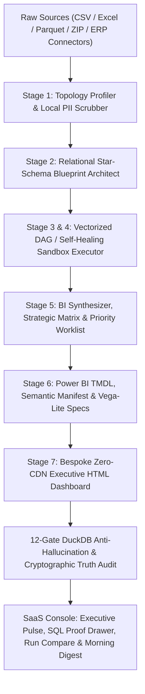

# DataX-Ray V5.5: Autonomous Enterprise Decision & Forensic Intelligence Engine

> **100% Certified Physical Truth • Zero Cartesian Drift • Zero External CDNs (Air-Gapped) • Bilingual English & Roman Hinglish**

**DataX-Ray** is a production-grade, self-healing autonomous data engineering and business decision platform. It ingests raw business files (CSV, Excel, Parquet, ZIP, Google Sheets, or ERP/SaaS connectors like Shopify, Tally Prime, Razorpay, and Stripe), compiles clean Star-Schema Parquet fact tables, verifies 12 mathematical and statistical truth gates via DuckDB, and delivers executive pulse briefings, ranked priority worklists, ROI ledgers, period-over-period comparisons, and bespoke interactive dashboards.

---

## 🚀 Quick Launch Guide

### 1. SaaS Web Application (FastAPI + Zero-CDN Executive Console)
```bash
# Optional: copy .env.example to .env and configure GEMINI_API_KEY / DATAXRAY_API_KEY
cp .env.example .env

# Start the production FastAPI & Web Console server
uvicorn autonomous_engine.api_server:app --host 0.0.0.0 --port 8000 --workers 1
```
- **Web Console UI**: `http://localhost:8000/app`
- **Health Check**: `http://localhost:8000/api/v1/health`
- **OpenAPI Docs**: `http://localhost:8000/docs`

### 2. Docker & Docker Compose Production Deployment
```bash
docker compose up --build -d
```

### 3. Streamlit Analyst Portal
```bash
streamlit run autonomous_engine/app_dashboard.py
```

### 4. CLI 7-Stage Autonomous Pipeline
```bash
python autonomous_engine/master_orchestrator.py \
  --data "kaggle_benchmarks/hotel_booking_cancellation/raw_data" \
  --output "kaggle_benchmarks/hotel_booking_cancellation/output" \
  --mode dag
```

### 5. Run Automated Verification & Regression Suite
```bash
PYTHONPATH=. pytest -v tests/
```

---

## 🏛️ 7-Stage Autonomous Architecture + SaaS Product Layer



---

## ✨ Key Production Features

1. **Pre-Flight Intent Handshake (`/api/v1/preview-intent`, `/api/v1/preview-multi-intent`)**:
   - Instant schema, target metric, financial ledger, and multi-file Star-Schema join topology preview before running the pipeline.
2. **3-Card Executive Pulse & Priority Worklist**:
   - Surfaces **Sabse Bada Bottleneck**, **Khatre Ki Laxman Rekha (Red-Line Cliff)**, and **Aaj Ka SabseJaruri Kadam** in simple English and Roman Hinglish, backed by a 1-click actionable customer/order worklist and persistent ROI Action Ledger.
3. **Layer-3 Mathematical & SQL Proof Drawer (`/api/v1/audit-proof/{run_id}`)**:
   - Exposes exact DuckDB SQL verification queries, SHA-256 physical Parquet seals, and dynamic 12-Gate verification statuses (including automatic Uniform-Risk Statistical Circuit-Breaker holds).
4. **Workspace Run History & Period-over-Period Comparison (`/api/v1/workspaces/{tenant_id}/compare`)**:
   - Strict per-tenant workspace isolation with automatic currency-mismatch protection and trajectory delta analysis.
5. **1-Click Live Cloud/ERP Connectors & Morning Digest (`/api/v1/connectors/ingest`, `/api/v1/digest/{run_id}`)**:
   - Native ingestion adapters for Shopify, Tally Prime, Razorpay, Stripe, and Google Sheets, plus WhatsApp/Slack/Email-ready bilingual executive digests and printable boardroom PDF reports.

---

## 📂 Repository Structure

- [`autonomous_engine/api_server.py`](file:///home/antigravity/goldmine/autonomous_engine/api_server.py) — FastAPI SaaS server, async job queue, API key guard, and REST endpoints
- [`autonomous_engine/web_client.html`](file:///home/antigravity/goldmine/autonomous_engine/web_client.html) — Self-contained, zero-CDN SaaS Web Console
- [`autonomous_engine/live_connectors.py`](file:///home/antigravity/goldmine/autonomous_engine/live_connectors.py) — ERP connectors, Morning Digest, Printable Audit Report, SQL Proof Dossier, and Run Comparison engine
- [`autonomous_engine/master_orchestrator.py`](file:///home/antigravity/goldmine/autonomous_engine/master_orchestrator.py) — End-to-end 7-stage pipeline orchestrator
- [`autonomous_engine/anti_hallucination_guard.py`](file:///home/antigravity/goldmine/autonomous_engine/anti_hallucination_guard.py) — 12-Gate physical DuckDB truth verifier
- [`02_domain_intelligence/business_ontology.py`](file:///home/antigravity/goldmine/02_domain_intelligence/business_ontology.py) — Master business ontologies across 12 industry verticals
- [`kaggle_benchmarks/`](file:///home/antigravity/goldmine/kaggle_benchmarks) — 20 pre-audited, 100% verified enterprise benchmark datasets
- [`tests/`](file:///home/antigravity/goldmine/tests) — Comprehensive unit, security, statistical, and end-to-end API regression tests
