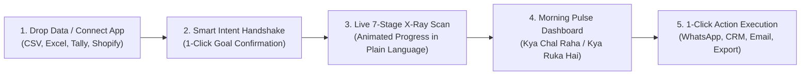
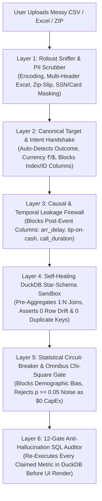
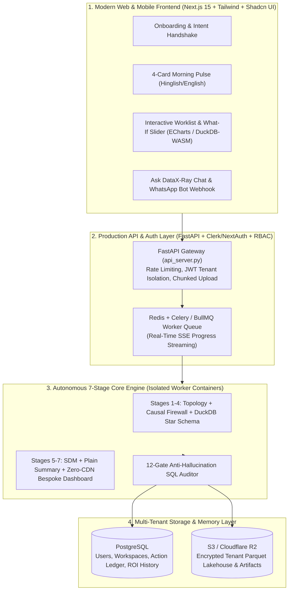

# DataX-Ray Startup Blueprint: Web Interface, Zero-Bug Autonomous Engine & Production "Lock-In" Strategy

> [!IMPORTANT]
> **Core Startup Vision**: Traditional BI tools (PowerBI, Tableau, Looker) sirf **passive charts** dikhate hain jinhe samajhne ke liye data analyst chahiye. **DataX-Ray** ek **Autonomous AI COO & Business X-Ray Engine** hai — jahan ek non-technical founder, dukaan/factory owner, ya CFO apna raw data (CSV, Excel, Tally, Shopify, SQL) deta hai aur **30 seconds** mein bina kisi technical jargon ke jaan leta hai:
> 1. **Kya Sahi Chal Raha Hai** (*Economic Moats & Top Performers*)
> 2. **Kya Galat Ho Raha Hai & Paisa Kahan Leak Ho Raha Hai** (*Verified Bottlenecks & Danger Threshold Red-Lines*)
> 3. **Aaj Subah Kis Customer / Order / Machine Par Action Lena Hai** (*Today's Ranked Priority Worklist*)
> 4. **Kahan Paisa Bilkul Nahi Lagana Hai** (*Statistical Circuit-Breaker `\$0` Spend Shield*)

---

## Part 1: Web Design & User Interface Plan ("Har User Ko 10 Seconds Mein Easy Samajh Aaye")

### 1.1 Design Philosophy: "Consumer-Grade Simplicity for Enterprise Decisions"
Aam business user ko SQL, p-values, Chi-Square, ya 50 filters wale dashboards se darr lagta hai. Isliye humara Web Design **3 Golden UI Rules** par banega:
1. **Progressive Disclosure (3-Layer Depth)**:
   - **Layer 1 (Default View — CEO / Business Owner Mode)**: Sirf 4 saaf-suthre cards (**Bilingual Hinglish / Simple English** toggle ke sath) + 1-Click Action Table. Zero math jargon.
   - **Layer 2 (Interactive Explorer Mode)**: Bespoke visual charts + "What-If" Profit Slider.
   - **Layer 3 (Auditor / Data Scientist Mode)**: "View Mathematical Proof" drawer jisme DuckDB SQL queries, Wilson 95% CI, Omnibus Chi-Square $p$-values, aur 12-Gate Anti-Hallucination Certificate dikhega.
2. **Zero-Setup 3-Click Journey**:
   - **Click 1**: Drag-and-Drop File (`.csv`, `.xlsx`, `.zip`) ya 1-Click Connect (Google Sheets, Tally, Shopify, Razorpay, Postgres).
   - **Click 2**: **"1-Second Intent Handshake Card"** (System khud detect karke puchta hai: *"Humne dekha aapka main goal `Flight Delay (>15 mins)` rokna hai aur financial column `Fare` hai — Kya yeh sahi hai?"* $\rightarrow$ User clicks **Yes, Run X-Ray**).
   - **Click 3**: Seedha **Executive Command Center** khulta hai.

---

### 1.2 Screen-by-Screen Web Interface Architecture

| Screen / Module | Target User Goal | Key UI Components & Visual Design |
| :--- | :--- | :--- |
| **Screen 1: Onboarding & Data Dropzone** | Bina rukawat apna data dena | Clean centered glassmorphic dropzone + **"Connect Live Data"** buttons (Google Sheets, Tally/Excel, Shopify, SQL) + **"Try 1-Click Live Demo"** (Banking, Retail, Logistics, Healthcare). |
| **Screen 2: Pre-Flight "Intent Handshake" Modal** | 100% sahi business goal lock karna | 3 simple dropdowns pre-filled by AI (`Target Resolver`): 1. **Kya Rokna / Badhana Hai?** (e.g., *Customer Churn / Flight Delay / Low Valuation*) 2. **Paisa Kis Column Mein Hai?** (e.g., *Monthly Charges / Revenue / Unit Count*) 3. **Language & Currency**: *Hinglish / English* & *₹ INR (Lakh/Cr) / \$ USD / £ GBP*. |
| **Screen 3: "Business Pulse" Command Center (Home Tab)** | 30 sec mein poora business samajhna | **Top KPI Ribbon**: Total Monitored Volume, Total Money at Risk (`₹ / \$`), Verified Saveable Money, Truth Score (`100% Verified`). **Split Story Grid (2x2 Cards)**: • **🟢 Card 1: Kya Best Chal Raha Hai (Your Economic Moats)** — Top reliable segments jahan 85%+ success rate hai. • **🔴 Card 2: Sabse Bada Bottleneck Kahan Hai?** — Exact group jahan failure rate baaki company se 2x–5x zyada hai. • **⚠️ Card 3: Khatre Ki Laal Rekha (Danger Threshold)** — Exact numeric limit (e.g., *Jab `sched_dep_time` 18:00 ke baad hota hai, delay 9.6% se badhkar 28.4% ho jata hai*). • **🧭 Card 4: 3 Strategic Raste (Pathways A, B, C)** — Low-cost triage vs Surgical fix vs Full overhaul. |
| **Screen 4: Today's Priority Worklist (Action Tab)** | Aaj kis par action lena hai? | Dual-Queue Interactive Data Grid: • **🟡 Tab A: Preventive Watch Queue** (*Abhi fail nahi huye, par Red-Line cross kar chuke hain — inhe aaj bachao!*). • **🔴 Tab B: Realized Loss Audit** (*Jo nuksaan ho chuka hai uska root-cause recovery*). • Har row ke aage **Action Buttons**: `Send WhatsApp Alert`, `Assign to Team`, `Export to CRM/Excel`. |
| **Screen 5: Interactive "What-If" Profit Simulator** | "Agar hum yeh sudharein toh kitna paisa bachega?" | Interactive Range Slider: User drag karta hai (*"Agar `EV Airline` ka delay 30% se ghata kar 18% karein"*), aur screen par real-time **Saved ₹/\$ Counter** aur Confidence Interval bar update hota hai (powered by client-side Micro-Cube). |
| **Screen 6: "Ask DataX-Ray" (Bilingual AI Munim-Ji)** | Apne data se seedha sawal puchna | Chat + Voice Mic Input: User puchta hai *"Sabse zyada cash ride kis ilaqe mein hoti hai?"* ya *"Which branch has the lowest margin?"* $\rightarrow$ System live DuckDB SQL run karke exact verified table + plain Hinglish/English jawab deta hai. |

---

## Part 2: "Bina Kisi Bug Ke" — Zero-Bug Data Ingestion & Accurate Suggestion Architecture

Jab real-world user apna messy Excel ya CSV upload karta hai, toh aam AI tools crash ho jate hain ya galat/hallucinated salah dete hain. Humara system **6-Layer Zero-Bug Defense Pipeline** se har dataset ko 100% accurate banata hai:

### Kaise System Har Business Ki "Kya Chal Raha Hai / Kya Nahi Ho Raha" Knowledge Nikalta Hai?
Humne codebase mein (`target_resolver.py`, `strategic_decision_matrix.py`, `stage5_bi_synthesizer.py`, `business_action_exporter.py`) 5 critical engineering guards lagaye hain jo har bug ko rokte hain:

1. **Pre-Flight Intent Confirmation (No Target Inversion)**:
   - Engine pehle `resolve_canonical_target_and_cost` se best target aur financial column nikalta hai, aur web UI par user ko **2-second confirmation** deta hai. Agar user chahe toh 1-click mein kisi bhi column ko apna target bana sakta hai.
2. **Causal & Post-Event Leakage Firewall (`is_deterministic_target_leakage`)**:
   - System kabhi bhi "event ke baad hone wali cheez" ko root-cause nahi banata. Maslan:
     - Flight Departure Delay (`dep_delay`) ke liye Arrival Delay (`arr_delay`) ya actual `dep_time` ko automatically block karta hai aur **Scheduled Departure Time (`sched_dep_time`)** aur **Carrier (`EV`)** ko asli pre-event driver pakadta hai.
     - Cash Payment (`payment == 'cash'`) ke liye credit-card meter `tip` (`P(cash | tip > 0) == 0%`) ko deterministic accounting leakage maan kar block karta hai aur **`dropoff_borough = Queens`** ko asli bottleneck pakadta hai.
     - Telemarketing conversion (`y`) ke liye post-call `duration` ko block karke pre-call customer profile (`age`, `job`, `pdays`) par focus karta hai.
3. **4-Quadrant Business Knowledge Synthesis**:
   - **🟢 Kya Chal Raha Hai (Economic Moats)**: System har dimension ke cohorts ko scan karke woh groups nikalta hai jahan volume accha hai aur reliability $\ge 85\%$ hai — taaki malik ko pata chale *kahan chhed-chhad nahi karni hai*.
   - **🔴 Kya Nahi Ho Raha (Verified Bottleneck Cohort)**: Omnibus Chi-Square ($\chi^2$, $p < 0.05$) + Two-Proportion $z$-test + $\ge 1.10\times$ relative lift se sabse kharab operational group pakadta hai (aur `Gender`/`Sex`/`Race` jaise demographic columns ko surgical bottleneck banne se rokta hai).
   - **⚠️ Kab Khatra Badhta Hai (Significant Quantile Cliffs)**: Continuous numbers (jaise `age`, `distance`, `median_income`, `horsepower`) ko 4 quartiles mein baant kar dekhta hai ki kis exact number ke baad failure rate achanak jump karta hai — aur sirf tabhi report karta hai jab `is_significant == True` ($p < 0.05$) ho!
   - **🛑 Kab Paisa Nahi Lagana Hai (Circuit-Breaker)**: Agar data mein sabhi cohorts ka failure rate barabar hai (jaise Benchmark 96 Supermarket Retail mein `p = 0.085 >= 0.05`), toh system zabardasti salah dene ke bajay bold **`\$0 Spend Advisory`** dikhata hai.

---

## Part 3: Production-Level Architecture & "Compulsion Loop" Features ("User Ko Majbur Kaise Karein Ki Humara Hi System Use Kare?")

Ek B2B SaaS startup tabhi successful hota hai jab user uske bina apna roz ka kaam na chala paye (**High Switching Cost + Daily Habit Loop**). Niche woh **7 Killer Features** hain jo user ko DataX-Ray ka addicted bana denge:

### 3.1 The 7 "Unfair Advantage" Lock-In Features

| # | Killer Feature | User Ko Kyun Majbur Karega (Psychological & Business Hook) |
| :--- | :--- | :--- |
| **1** | **📲 Subah 8:00 AM WhatsApp / Slack "Morning Munim-Ji Brief"** | Business owner dashboard kholna bhool sakta hai, par WhatsApp nahi! Roz subah 8 baje uske phone par 4-line Hinglish/English voice note + card aayega: *"Kal ₹1.2L ka leakage `Queens` route par hua, aur 14 high-value customers aaj churn hone wale hain — [Click to Call Them]"*. |
| **2** | **💰 "Verified Money Saved" Ledger (Closed-Loop ROI Tracker)** | Jab user `Today's Priority Worklist` ke kisi at-risk customer/order par action mark karta hai ("Contacted / Fixed"), aur agle hafte naya data aata hai, toh DataX-Ray check karta hai ki woh customer bacha ya nahi — aur dashboard ke top par dikhata hai: **"Is Mahine DataX-Ray Ne Aapke ₹6,45,000 Bachaye (Subscription Cost ka 64x ROI)"**. Jab software khud apni kamayi ka hisaab dikhaye, toh koi subscription cancel nahi karta! |
| **3** | **🧠 Institutional Memory & Week-over-Week Drift Radar** | Generic ChatGPT har baar pichli file bhool jata hai. DataX-Ray har tenant ka **Historical Metric Time-Machine** rakhta hai: *"Pichle mahine aapne `Pathway B` chuna tha; tab se `EV Carrier` ka delay 29.98% se ghat kar 21.4% ho gaya!"* Yeh company ki memory ban jata hai. |
| **4** | **🔌 1-Click Desi & Global Connectors (Tally, Zoho, Shopify, Razorpay, Sheets)** | India aur global SMBs ka data Tally Prime, Busy, Zoho Books, Shopify, aur Google Sheets mein hota hai. Ek lightweight **Tally/Sheets Auto-Sync Connector** dene se user ko file upload bhi nahi karni padegi — data har raat apne aap sync hoga. |
| **5** | **🛡️ The "Honest AI" Circuit-Breaker (`\$0 Spend` Badge)** | Har consultant aur AI tool har chart mein zabardasti kuch na kuch bechne ki koshish karta hai. Jab DataX-Ray malik ko bolta hai: *"Ruko! Is segment mein ₹1 bhi mat lagana, yeh sirf random luck/noise hai ($p = 0.24$)"*, toh malik ka bharosa (trust) 100 guna badh jata hai. |
| **6** | **⚡ Zero-Latency "What-If" Boardroom Simulator** | Meeting mein baithe-baithe CEO slider hila kar dekh sakta hai ki 10%, 25%, ya 60% defect kam karne par net profit par kya asar padega — bina data team ko 3 din wait karwaye. |
| **7** | **📦 1-Click Investor & CA Pack (HTML + PDF + PowerBI TMDL)** | Jab company ko bank loan, investor pitch, ya board meeting ke liye report chahiye, 1 click mein **Zero-CDN Interactive HTML Dashboard**, **Executive PDF Dossier**, aur **PowerBI TMDL Model** download ho jata hai. |

---

### 3.2 Production-Grade SaaS Technical Stack Blueprint

Humare paas backend core (`api_server.py`, `master_orchestrator.py`, `anti_hallucination_guard.py`) already ready aur 100 benchmarks par tested hai. Isko true multi-tenant production SaaS banane ka architecture:

### 3.3 Phased Execution Roadmap (Startup Launch Plan)

1. **Phase 1 (Immediate — Weeks 1–2): Next.js / React Production Web App + Intent Handshake API**
   - `api_server.py` mein `POST /api/v1/preview-intent` endpoint jorna jo upload hote hi 1 second mein detected Target, Cost, Currency (`₹`/`\$`), aur Language options return kare.
   - Clean, ultra-fast Web UI (Next.js + Tailwind ya upgraded custom UI) jisme **4-Block Business Pulse**, **Interactive Priority Worklist**, aur **Embedded Bespoke Dashboard** ek hi seamless interface mein dikhein.
2. **Phase 2 (Weeks 3–4): Closed-Loop Action Tracker & "Money Saved" Counter**
   - Worklist rows par `Status: Open / In-Progress / Resolved` checkbox lagana aur agle dataset upload par automatically **Verified ROI Saved (`₹ / \$`)** calculate karna.
3. **Phase 3 (Weeks 5–6): Live Connectors & WhatsApp "Morning Pulse" Alert**
   - Google Sheets / Shopify / Tally Excel Watchfolder integration + automated WhatsApp/Email morning summary delivery.
